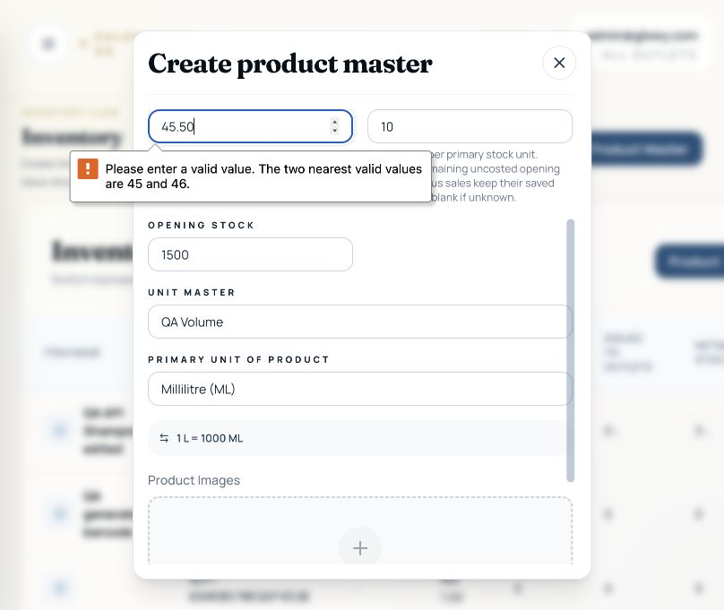
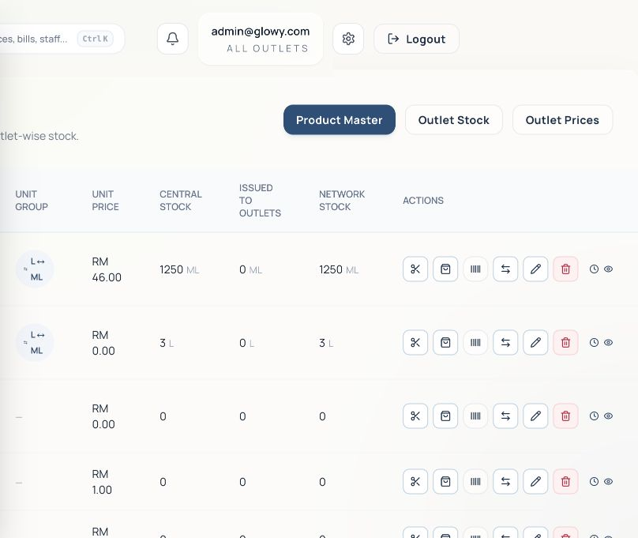
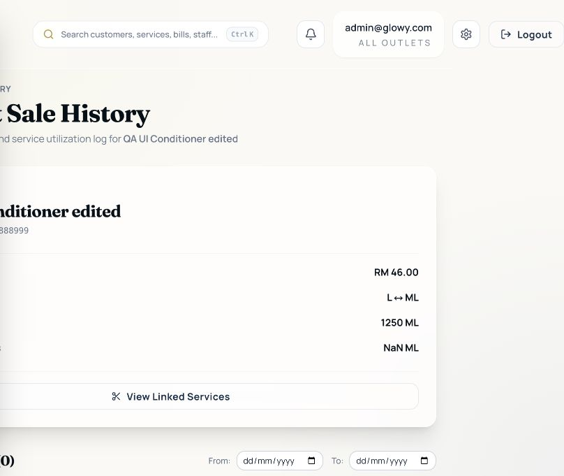
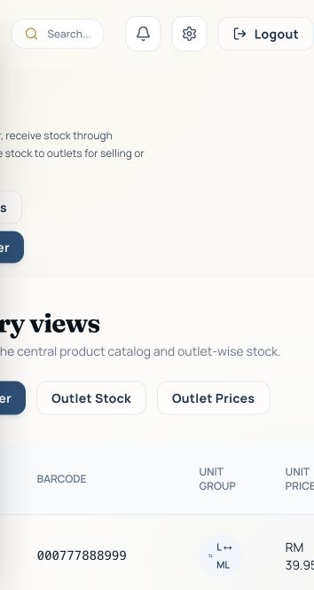
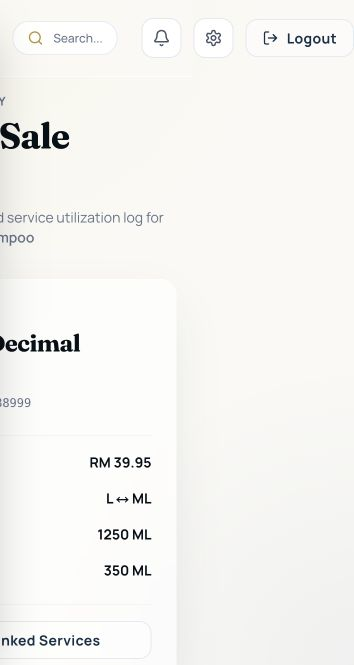

# Product Master testing — 31 October 2026

The project runs locally. Frontend: http://127.0.0.1:5173/inventory. Backend health: http://localhost:5001/health.

The working tree already contained substantial staged, unstaged, and untracked changes, and `backend/src/app.js` was marked unmerged in Git, although its working copy had no conflict markers. Existing work was preserved. No application source files were changed by this testing session.

## Test environment and results

- Started the normal Vite frontend and Node/MySQL backend. Normal backend startup performs its built-in model synchronization/migration checks. WhatsApp and thermal printing were disabled for this process.
- Verified demo admin sign-in and loading the existing Product Master catalog against the normal local database.
- Ran `npm run build`: passed. Non-blocking warnings: stale Browserslist data and large JavaScript bundle.
- Ran `node --test src/utils/__tests__/*.test.js`: **13 passed**.
- Ran `npm run test:inventory` in `backend`: **21 passed**, using the repository's isolated schema test runner.
- Ran **16 targeted Product Master API scenarios: 11 passed, 5 failed**. Schema was cloned without business rows into a temporary QA database; synthetic admin, manager, unit, outlet, and product fixtures were used. A separate frontend on port 5174 and API on port 5002 supported browser testing.
- Verified manager write access again through a real login with a synthetic outlet-manager account, rather than relying only on a test-signed token.

## Confirmed defects

### PM-01 — High: outlet-manager accounts can write to Product Master

1. In the isolated database, create an account in `admins` with role `outlet_manager`.
2. Sign in through `POST /api/auth/login` using that account's credentials.
3. Use its returned token for `POST /api/products`, `PUT /api/products/:id`, and `DELETE /api/products/:id`.

Actual: create returns **201**, edit **200**, archive **200**. Expected: these administrator routes reject a non-admin business role with **403**. The routes use `requireAdmin`, whose `userType === 'admin'` exception grants access based on the account's storage type. Relevant code: `backend/src/middleware/auth.js:26` and `backend/src/routes/products.js`. Evidence: [extra-results.json](product-master-qa-2026-10-31/extra-results.json).

### PM-02 — High: decimal selling prices cannot be saved in the UI

1. Inventory → Add Product Master.
2. Enter an item name and selling price **45.50**.
3. Click Save Product Master.

Actual: browser validation blocks submission: “The two nearest valid values are 45 and 46.” Expected: currency values with two decimal places can be saved. The API successfully accepts a decimal price (25.50), so frontend and backend disagree. Both create and edit selling-price inputs omit `step`, defaulting to whole-number increments. Browser reproduction performed on create; the same missing attribute was inspected on edit. Relevant code: `src/pages/inventory/InventoryPage.jsx:1139` and `:1002`.

### PM-03 — Medium: archived products remain actionable after “deleted” success

1. Create a test product, then use its Delete Product action.
2. After success, inspect the Product Master table.

Actual: the page says the product was “deleted,” but the row stays visible with edit, delete, issue, and label actions. Database verification shows `status: inactive`. Expected: communicate archival accurately and distinguish or filter inactive products. The backend intentionally archives to preserve history; the frontend requests all statuses and exposes no archive status indicator or filter. Relevant code: `src/pages/inventory/InventoryPage.jsx:128` and `:287`, plus `backend/src/controllers/productController.js` `remove`.

### PM-04 — Medium: null selling price silently becomes zero on edit

Request: `PUT /api/products/:id` with `{"unit_price":null}`.

Actual: **200**, persisted `unit_price: 0`. Expected: **400**, preserving the previous price. `Number(null)` passes update validation, while creation uses stricter numeric validation. Relevant code: `backend/src/controllers/productController.js:142`. This can turn a priced product into a free item through an integration or malformed request.

### PM-05 — Medium: whitespace-only product names are accepted

Request: `POST /api/products` with `{"item_name":"   ","unit_price":1}`.

Actual: **201**, persisted `item_name: ""`, resulting in a nameless catalog row. Expected: **400** after validating the trimmed name. Relevant code: `backend/src/controllers/productController.js:75` and the subsequent `item_name.trim()` assignment.

### PM-06 — Medium: invalid unit group produces HTTP 500

Request: `POST /api/products` with `{"item_name":"QA bad unit","unit_price":1,"unit_master_id":99999999}`.

Actual: **500**, generic “Server error.” The log identifies a foreign-key violation. Expected: a client validation response (**400**) identifying the invalid unit group. Relevant code: `backend/src/controllers/productController.js` unit-master conversion and `productWriteError`.

### PM-07 — Medium: sale-history stock summary displays NaN

1. Create a product using QA Volume (L ↔ ML), choose ML, and set opening stock to 1500.
2. Edit opening stock to 1250, then open View Sale History.

Actual: **“Issued to Outlets NaN ML”**, although this product has no stock issues. Expected: **0 ML**. The detail response does not supply the `issuedStock` field read by the history screen. Relevant code: `src/pages/inventory/ProductSaleHistoryPage.jsx:282`.

### PM-08 — Low: missing product updates return 400 instead of 404

Request: `PUT /api/products/99999999` with `{"unit_price":1}`.

Actual: **400**, “Product not found.” Expected: **404**, consistent with `GET /api/products/:id`. The update path uses the generic validation helper for a missing record. Relevant code: `backend/src/controllers/productController.js` `update`.

## Working flows observed

- Demo sign-in and Product Master loading against the normal app.
- Unauthenticated product reads return 401.
- Create with decimal price through the API, opening stock, acquisition cost, and unit association.
- Leading-zero barcodes survive create, list/search, edit, and label preview.
- Duplicate barcodes return 409; numeric barcode input returns 400; blank barcodes generate identifiers.
- Negative prices and opening stock return 400.
- Opening stock creates the corresponding inventory cost lot.
- Name/price/stock edits retain barcode identity and update central stock.
- Changing a unit group after inventory history exists is rejected.
- Browser creation with 1500 ML stores 1.5000 L; editing to 1250 ML stores 1.2500 L and reopens correctly.
- Duplicate-barcode edit feedback appears in the modal and prevents the update.
- Single-product thermal label preview displays the correct name, barcode, and RM 46.00 price.
- A4 preview with quantity three displays three labels on one sheet.
- Archive API preserves the record and excludes it when explicitly querying `status=active`.
- Sale-history and linked-service empty states load, subject to PM-07.

## Scope limits and artifacts

This was an initial functional and validation pass, not a release sign-off. Physical printing, image uploads, sales with populated history, full purchase/issue workflows, concurrent UI submissions, and responsive/device coverage were not exercised in this pass. Existing automated inventory tests cover costing, transfers, sales edits, overselling, and lock serialization.

API evidence is in [results.json](product-master-qa-2026-10-31/results.json). Screenshots and the additional real-login role check are in [product-master-qa-2026-10-31](product-master-qa-2026-10-31/). Temporary QA services and schemas are removed after testing; the normal frontend and backend remain running. Existing business product and stock rows were not edited by the test cases.

## Fix verification — bugs 2–8

Bugs **PM-02 through PM-08 are fixed and verified**. PM-01 (manager access) was explicitly excluded by the user; authentication middleware and product route permissions were not changed.

- PM-02: create/edit selling-price fields support increments of RM 0.01 and require a value. Browser creation at RM 45.50 and edit to RM 39.95 both passed.
- PM-03: the Product Master page requests active products. The action, confirmation, and success feedback say Archive and explain history retention. Browser archival removed the row; the archived product's history URL remained accessible.
- PM-04: updates use the same strict numeric validation as creation. Null, empty, whitespace, boolean, malformed, and negative prices return 400 without changing price or stock. Explicit zero remains supported.
- PM-05: create/edit normalize and validate names, rejecting empty, whitespace-only, non-string, or overlong names with 400.
- PM-06: create/edit validate unit identifiers and existence before writing. Invalid unit groups return a specific 400 message.
- PM-07: sale history calculates issued stock from current outlet inventory, using the same outlet scope as the rest of the page. Browser checks showed 0 ML for no outlet stock, then 350 ML for two fixture balances of 0.25 L and 0.10 L.
- PM-08: missing product updates and archives return 404, consistent with reads.

Validation: **27 backend tests passed** (including 6 new Product Master API regression tests), **13 frontend tests passed**, and the frontend production build passed. The isolated 16-scenario API retest passed all checks, with its manager-access scenario explicitly expecting the unchanged behavior. Evidence: [fixed-api-results.json](product-master-qa-2026-10-31/fixed-api-results.json).

New regression suite: `backend/tests/productMaster.test.js`; run through `npm run test:inventory` in `backend` to use a disposable schema. The suite refuses committed HTTP writes against a business database.

## Regression audit after fixes

Result: **No regression found in the affected flows tested.** No further application-code changes were needed. Added three regression scenarios to `backend/tests/productMaster.test.js` and made the test suite load the app only after verifying that it is using a disposable schema.

Validated the complete flow through real HTTP routes in an isolated database:

1. Create a product with a unit group, opening quantity, acquisition cost, and pack conversion.
2. Receive a purchase order entered in secondary units. Check converted base stock.
3. Issue stock to an outlet and set a decimal outlet selling price.
4. Load the POS catalog with product, linked service, and linked package.
5. Complete one mixed product/service/package checkout. Check stock consumption and FIFO costs for all three lines.
6. Rename and reprice the product through Product Master while preserving opening stock and its unit group. Check that saving unchanged opening stock does not add stock again.
7. Read the previous invoice and confirm its original price. Increase its sold product quantity, then verify updated outlet stock, original barcode, saved acquisition costs, and profit-report cost.
8. Archive the product. Confirm that it disappears from the active POS catalog while existing purchase orders, invoices, service/package definitions, and unfiltered historical product lookups remain available. Check that the purchase order retains its original product name and barcode.

Also tested price-only edits on products without unit groups, preservation of images/barcodes/other omitted fields, and saving existing products whose unit group has since become inactive. Reviewed product API callers: only Product Master's own list was switched to the active filter; the shared list API and historical lookup callers were unchanged.

Browser smoke checks on the running app: Product Master, Outlet Stock, Outlet Prices, Purchase Orders, Services, Packages, POS, and Billing History loaded. No browser console errors were reported during these navigation checks. Browser checks were read-only; checkout and other writes used isolated synthetic fixtures.

Final checks: **30 backend tests passed**, **13 frontend tests passed**, production build passed, and whitespace checks passed. Existing non-blocking build warnings remain for bundle size and Browserslist age. [Backend audit log](product-master-qa-2026-10-31/regression-audit.log).

This audit covers the affected product/inventory/billing paths; it does not prove every unrelated module or physical printer/WhatsApp integration. Bug 1 remains excluded as requested. All committed test writes were confined to disposable schemas, which the runner removes.
